# DOUBLE-LINKED CIRCULAR LIST

### This program simulates the work of a double-linked circular list with fictional element based on **indexes, but not pointers**

## INSTRUCTIONS

**To launch the program, you need to:**

1. Create folder for programm

2. Choose data type for your list and write it in bat file. You have 2 options:

1) LIST_USE_INT
2) LIST_USE_DOUBLE

**EXAMPLE**
```C
g++ -g -DLIST_USE_INT -DLIST_DEBUG main.cpp listing_functions.cpp list_dump.cpp -o list.exe ^
-Wshadow -Winit-self -Wredundant-decls -Wcast-align -Wundef -Wfloat-equal -Winline -Wunreachable-code ^
-Wmissing-declarations -Wmissing-include-dirs -Wswitch-enum -Wswitch-default -Weffc++ -Wmain -Wextra -Wall -g -pipe ^
-fexceptions -Wcast-qual -Wconversion -Wctor-dtor-privacy -Wempty-body -Wformat-security -Wformat=2 -Wignored-qualifiers ^
-Wlogical-op -Wno-missing-field-initializers -Wnon-virtual-dtor -Woverloaded-virtual -Wpointer-arith -Wsign-promo ^
-Wstack-usage=8192 -Wstrict-aliasing -Wstrict-null-sentinel -Wtype-limits -Wwrite-strings -Werror=vla -D_DEBUG ^
-D_EJUDGE_CLIENT_SIDE
.\list.exe
```

3. Run bat file
```C
PS D:\C\Listing> .\list.bat
```
## USAGE

## Commands

1. error_t list_init(struct list_t* list, int size); **inits your list**
2. error_t list_destroy(struct list_t* list); **destroys your list (free all calloc)**
3. error_t list_insert(struct list_t* list, int node, list_elem_t data); **inserts data after some node !!!!It isn't logical node, but array index**
4. error_t list_delete(struct list_t* list, int node); **deletes data in given node and fills this node with FREE !!!!It isn't logical node, but array index**

## DEBUG

### You have 2 modes: WITH and WITHOUT DEBUG

1. To turn on DEBUG you should write debug-flag LIST_DEBUG

<details>
<summary>EXAMPLE:</summary>

```C
g++ -g -DLIST_USE_INT -DLIST_DEBUG main.cpp listing_functions.cpp list_dump.cpp -o list.exe ^
-Wshadow -Winit-self -Wredundant-decls -Wcast-align -Wundef -Wfloat-equal -Winline -Wunreachable-code ^
-Wmissing-declarations -Wmissing-include-dirs -Wswitch-enum -Wswitch-default -Weffc++ -Wmain -Wextra -Wall -g -pipe ^
-fexceptions -Wcast-qual -Wconversion -Wctor-dtor-privacy -Wempty-body -Wformat-security -Wformat=2 -Wignored-qualifiers ^
-Wlogical-op -Wno-missing-field-initializers -Wnon-virtual-dtor -Woverloaded-virtual -Wpointer-arith -Wsign-promo ^
-Wstack-usage=8192 -Wstrict-aliasing -Wstrict-null-sentinel -Wtype-limits -Wwrite-strings -Werror=vla -D_DEBUG ^
-D_EJUDGE_CLIENT_SIDE
.\list.exe
```
</details>

2. To turn off DEBUG_MODE you shouldn't include debug flag in bat file

<details>
<summary>EXAMPLE:</summary>

```C
g++ -g -DLIST_DEBUG main.cpp listing_functions.cpp list_dump.cpp -o list.exe ^
-Wshadow -Winit-self -Wredundant-decls -Wcast-align -Wundef -Wfloat-equal -Winline -Wunreachable-code ^
-Wmissing-declarations -Wmissing-include-dirs -Wswitch-enum -Wswitch-default -Weffc++ -Wmain -Wextra -Wall -g -pipe ^
-fexceptions -Wcast-qual -Wconversion -Wctor-dtor-privacy -Wempty-body -Wformat-security -Wformat=2 -Wignored-qualifiers ^
-Wlogical-op -Wno-missing-field-initializers -Wnon-virtual-dtor -Woverloaded-virtual -Wpointer-arith -Wsign-promo ^
-Wstack-usage=8192 -Wstrict-aliasing -Wstrict-null-sentinel -Wtype-limits -Wwrite-strings -Werror=vla -D_DEBUG ^
-D_EJUDGE_CLIENT_SIDE
.\list.exe
```
</details>

## DEBUG MODE

### ERROR CODES AND USAGE

You have only this errors for your programm
```C
    struct error error_array[] =
    {
        {"Everything is OK", OK},
        {"NULL pointer of node_array", LIST_NULL_POINTER},
        {"Realloc didn't find place to replace list", NULL_POINTER_FROM_REALLOC},
        {"Tou wanna delete negative node", NEGATIVE_NODE},
        {"NO list structure was inited", NO_LIST_INITTED},
        {"You wanna delete or add after non-existent node", NOT_EXSIST_ELEM},
        {"You wanna delete zero node", ZERO_NODE_TO_DELETE},
        {"Size less than ZERO", WRONG_SIZE},
        {"Zero element was damaged", ZERO_ELEM_DAMAGED},
        {"Wrong value of next member in node structure", WRONG_NEXT},
        {"Wrong value of prev member in node structure", WRONG_PREV},
        {"Calloc didn't work", BAD_ALLOCATION},
        {"Next or previous element index more than size of list",  IDX_MORE_THAN_SIZE},
        {"Next or previous element index less than zero", NEGATIVE_IDX},
        {"Tail index more than size of list", WRONG_TAIL},
        {"Head index more than size of list", WRONG_HEAD},
        {"Free index more than size of list", WRONG_FREE}
    };
```

### EXAMPLE OF MAIN
```C
int main(void)
{
    error_t error_status = OK;
    struct list_t list = {};
    DUMP_INIT(list);
    DEFINE_LOG_FILE();

    error_status = list_init(&list, 5);
    ASSERT(list, error_status);
    list_dump(&list);

    error_status = list_insert(&list, 0, 20);
    ASSERT(list, error_status);
    list_dump(&list);

    error_status = list_insert(&list, 1, 30);
    ASSERT(list, error_status);
    list_dump(&list);

    error_status = list_insert(&list, 2, 40);
    ASSERT(list, error_status);
    list_dump(&list);

    error_status = list_destroy(&list);
    ASSERT(list, error_status);

    return 0;
}
```

### DUMP FORMAT

 You can call **list_dump(struct list_t* list)** function -> go to LOG folder -> go to your last run programme folder -> look all dumps (**html** or **txt**)

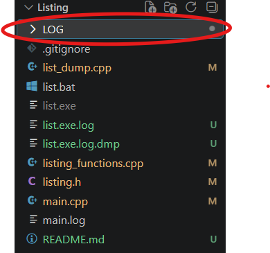

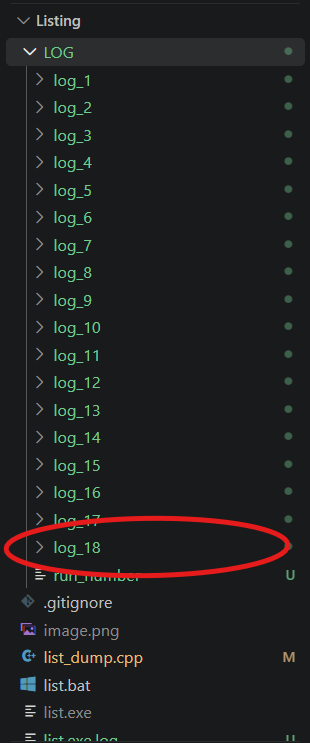

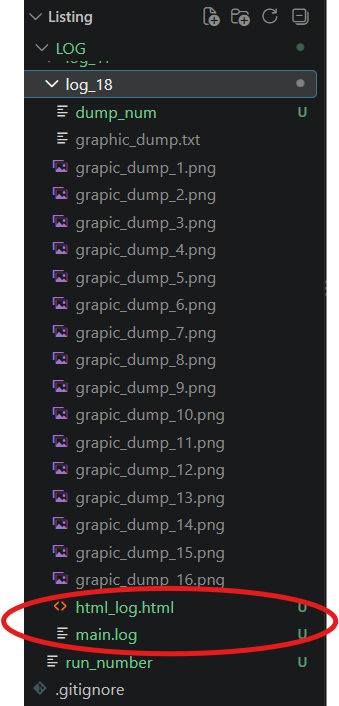

### EXAMPLE OF TXT LOG

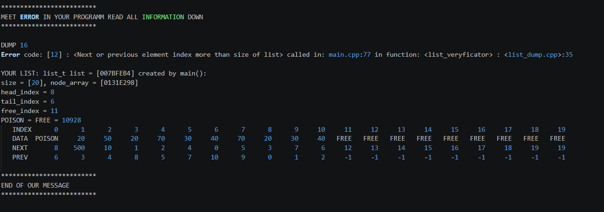

### EXAMPLE OF HTML LOG

<details>
<summary>1. Damaged element with NEXT < 0</summary>

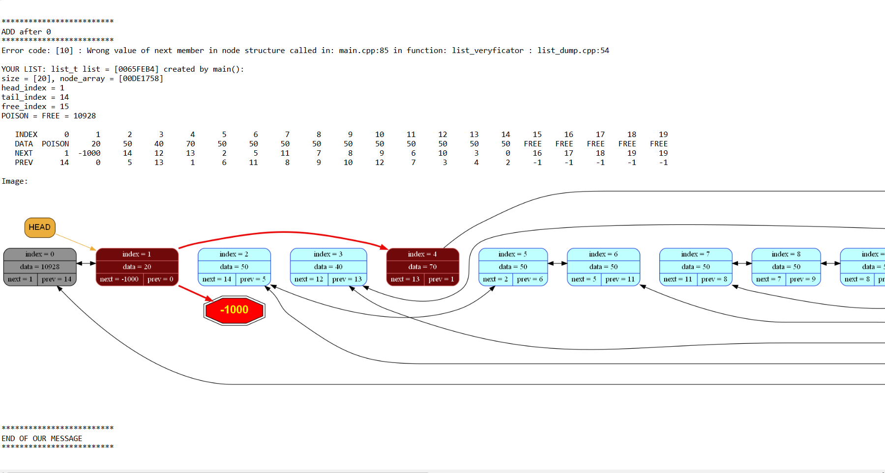

</details>

<details>
<summary>2. Damaged element with PREV < 0</summary>

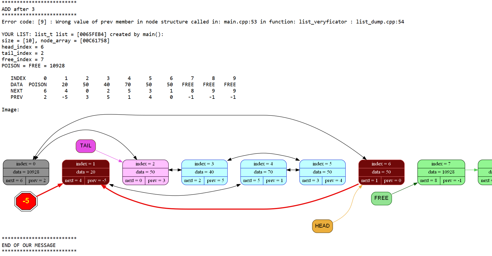

</details>

<details>
<summary>3. Damaged element with PREV > SIZE</summary>

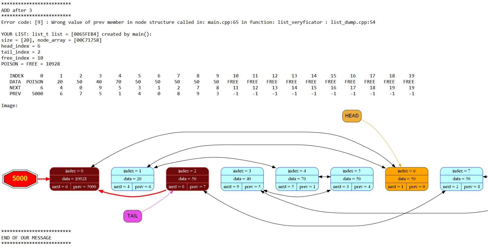

</details>

<details>
<summary>4. Damaged element with NEXT > SIZE</summary>

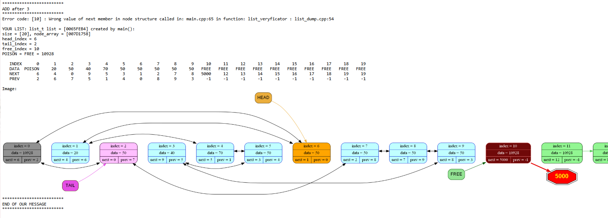

</details>

<details>
<summary>5. Damaged element with wrong NEXT in range of list</summary>

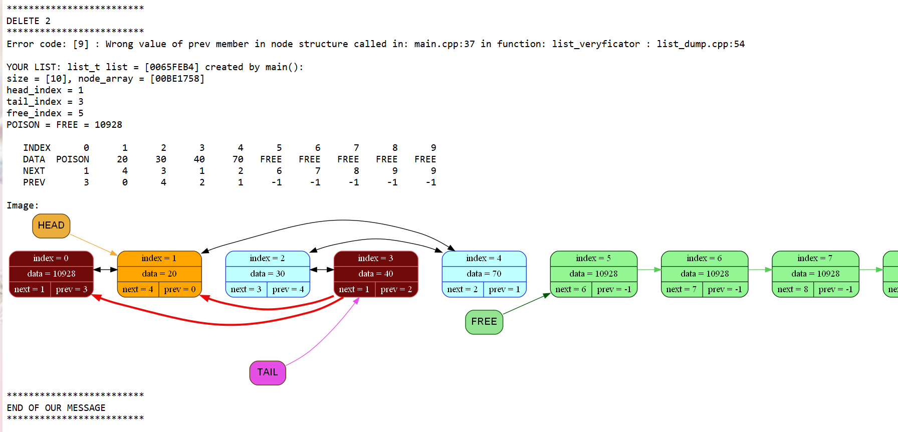

</details>

<details>
<summary>6. Damaged element with wrong PREV in range of list</summary>

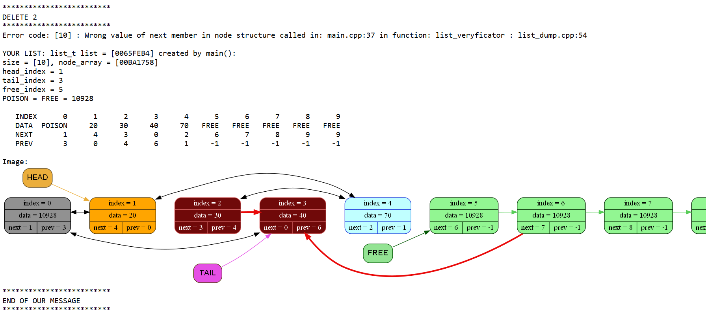

</details>

<details>
<summary>7. Damaged list with 2 circular buffers </summary>

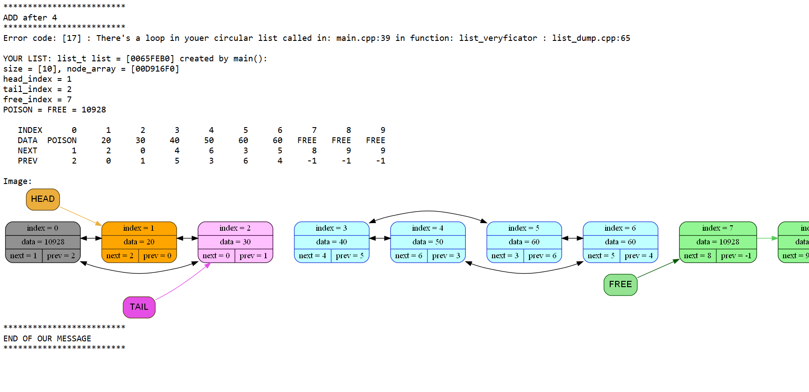

</details>

### **Hall of Fame**

• **Code Architect & Bug Factory: [[My GitHub link](https://github.com)]**

• **Code reviewer & motivator: [[sizeof.lj.ru](https://sizeof.livejournal.com)]**

• **Moral Support & Mental Stability: My playlist on Spotify**

• **Inspiration: Pure stubbornness and a refusal to let the compiler win.**

